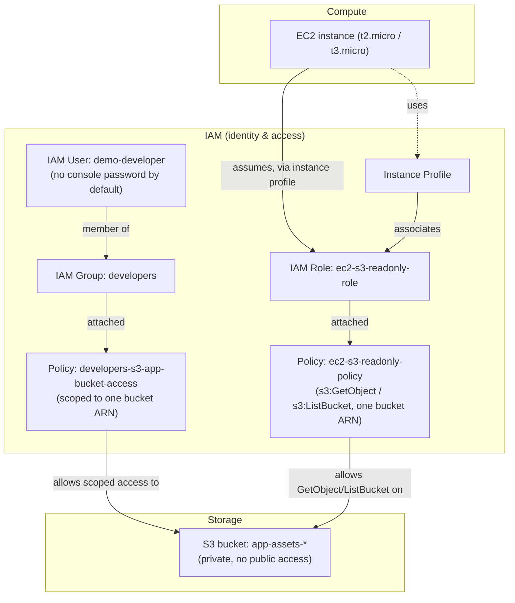

# AWS IAM Least-Privilege Lab

A hands-on lab that provisions a **least-privilege IAM setup** for a small team and a workload, and demonstrates **secure EC2-to-S3 access using an IAM role** — no access keys ever embedded in code, config, or the instance.

Built while studying for the **AWS Certified Cloud Practitioner (CLF-C02)** exam, as a practical complement to the IAM theory in the "Security and Compliance" domain.

> ⚠️ **Status**: this Terraform configuration was hand-written against the AWS provider docs, but neither `terraform validate` nor `terraform apply` has been run — this environment has no Terraform CLI or AWS credentials installed. Run `terraform init && terraform validate` yourself before `apply` (see [Setup](#setup)), and treat this as reviewed-but-unexecuted code rather than a tested one.

## Table of contents
- [Learning objectives](#learning-objectives)
- [Use case](#use-case)
- [Architecture](#architecture)
- [Why these services](#why-these-services)
- [Repository structure](#repository-structure)
- [Setup](#setup)
- [Testing](#testing)
- [Cleanup](#cleanup)
- [Cost considerations](#cost-considerations)
- [Security notes](#security-notes)
- [Troubleshooting](#troubleshooting)
- [Limitations & future improvements](#limitations--future-improvements)
- [References](#references)

## Learning objectives

After working through this lab you should be able to:
- Explain the difference between an IAM **user**, **group**, **role**, and **policy**.
- Write a least-privilege IAM policy scoped to a specific resource ARN and a minimal action set, instead of reaching for AWS-managed "FullAccess" policies.
- Explain why an **IAM role with an instance profile** is the correct way to give an EC2 instance access to another AWS service, and why long-lived access keys on an instance are an anti-pattern.
- Use the **IAM Policy Simulator** / `iam:SimulatePrincipalPolicy` to check "can this principal do X?" before granting it.
- Read an IAM policy's `Effect`, `Action`, `Resource`, and `Condition` blocks and predict what it allows or denies.

## Use case

A small team is building an application that reads product images from an S3 bucket from an EC2 instance. Two roles exist:

- **Developers** (IAM group `developers`): need to upload and manage objects in the *application* S3 bucket only, from the AWS Console or CLI with their own IAM user credentials. They must **not** be able to touch IAM, billing, or any other bucket in the account.
- **The application itself** (EC2 instance): needs **read-only** access to the same bucket. It must never have an IAM user's access keys stored on it — if the instance is ever compromised, the blast radius should be "read a few objects in one bucket," not "full account access."

This mirrors a very common real-world least-privilege request during the exam and in interviews: *"How would you let an EC2 instance read from S3 without hardcoding credentials?"*

## Architecture



No long-term credentials ever leave IAM: the EC2 instance obtains **temporary, automatically-rotated credentials** from the instance metadata service through the instance profile.

## Why these services

| Service | Why it was chosen |
|---|---|
| **IAM** | Identity and access management is free, account-wide, and is the mechanism AWS expects you to use for every permission decision — it's also a core CLF-C02 exam topic. |
| **IAM Roles + Instance Profiles** | The AWS-recommended way to grant AWS API access to an EC2 instance. Credentials are temporary and automatically rotated, and never stored on disk. |
| **S3** | A realistic, cheap target resource to scope permissions against, with a well-understood ARN format (`arn:aws:s3:::bucket-name/*`) that makes least privilege easy to demonstrate. |
| **Terraform** | Makes the whole IAM graph (user, group, role, policies, instance profile) reviewable as code and reproducible, instead of a pile of console screenshots. |

## Repository structure

```
aws-iam-least-privilege-lab/
├── README.md
├── LICENSE
├── .gitignore
├── terraform/
│   ├── main.tf              # S3 bucket, IAM group/user/role/instance profile, EC2 instance
│   ├── variables.tf         # Input variables (region, bucket name, toggle for demo IAM user)
│   ├── outputs.tf           # Useful outputs (bucket name, role ARN, instance ID)
│   └── terraform.tfvars.example
├── policies/
│   ├── ec2-s3-readonly-policy.json       # Role policy, for reference / policy simulator
│   └── developers-s3-app-bucket-access.json
└── scripts/
    └── verify-instance-access.sh         # Runs ON the EC2 instance to prove role-based access works
```

## Setup

**Prerequisites**: an AWS account (Free Tier is enough), [Terraform](https://developer.hashicorp.com/terraform/install) ≥ 1.5, AWS CLI v2 configured with an admin or power-user identity (`aws configure`) — this identity is only used to *create* the lab resources, not by the EC2 instance.

```bash
cd terraform
cp terraform.tfvars.example terraform.tfvars
# edit terraform.tfvars: set a globally-unique bucket_name

terraform init
terraform fmt -check
terraform validate
terraform plan    # review exactly what will be created before applying
terraform apply   # type "yes" to confirm
```

`terraform apply` will create (all Free-Tier eligible, see [Cost considerations](#cost-considerations)):
- One private S3 bucket.
- One IAM role + instance profile scoped to that bucket.
- One IAM group + scoped policy (and, optionally, one IAM user with no console password — see `create_demo_iam_user` in `variables.tf`, default `false`, since most people testing this lab don't need an extra IAM user lying around).
- One `t3.micro` EC2 instance (covered by the Free Tier for the first 12 months on a new account) with the instance profile attached, running Amazon Linux 2023.

## Testing

1. Note the `instance_id` and `bucket_name` from `terraform output`.
2. Connect to the instance via **Session Manager** (no SSH key or open port 22 needed — see `aws ssm start-session --target <instance_id>`) or SSH if you added a key pair.
3. From the instance, confirm there are **no credentials configured** other than the role:
   ```bash
   aws configure list   # should show "node" / "env" sources only, no access key
   ```
4. Run the verification script, which the instance already has via user-data, or copy it manually:
   ```bash
   bash /opt/verify-instance-access.sh <bucket_name>
   ```
   It calls `aws s3 ls s3://<bucket_name>` and `aws s3 cp` a test object — both should succeed using only the instance's temporary role credentials.
5. Confirm the *negative* case: try `aws s3 ls` against a **different** bucket you own, or try `aws iam list-users` from the instance. Both must fail with `AccessDenied` — that's least privilege working as intended.
6. Optional — use the **IAM Policy Simulator** (console or `aws iam simulate-principal-policy`) against the role ARN to test `s3:DeleteObject` or `s3:PutBucketPolicy`: both should simulate as `implicitDeny`, since the policy only grants `GetObject`/`ListBucket`.

## Cleanup

```bash
cd terraform
terraform destroy   # type "yes" to confirm
```

Double-check in the console afterwards that the S3 bucket, EC2 instance, IAM role, instance profile, and IAM group/user were removed — S3 bucket deletion can fail (and be skipped by `destroy`) if objects were added outside Terraform and versioning left old versions behind; empty the bucket manually first if that happens.

## Cost considerations

- **IAM** (users, groups, roles, policies) is **always free**.
- The **EC2 `t3.micro`** instance is Free-Tier eligible (750 hrs/month) for the first 12 months on a new account; outside the Free Tier it's a few cents/hour — destroy it when you're done.
- **S3** storage/requests for a handful of small test objects is effectively free under the Free Tier (5 GB, 20k GET / 2k PUT per month).
- Running `terraform destroy` as soon as you finish testing avoids any ongoing charges.

## Security notes

- The EC2 instance **never** receives an access key/secret — only temporary, auto-rotated credentials via the instance profile. This is the control this whole lab exists to demonstrate.
- The role's policy is scoped to **one bucket ARN** and **two actions** (`s3:GetObject`, `s3:ListBucket`) — not `AmazonS3ReadOnlyAccess`, which would grant read access to *every* bucket in the account.
- The optional demo IAM user is created **without** a console password or access key by default; enabling real credentials for it is left to you deliberately, so nothing sensitive is ever auto-generated by this repo.
- `*.tfvars`, `*.tfstate`, and any `.pem` key are in `.gitignore` — never commit them. Only `terraform.tfvars.example` (no real values) is tracked.
- The S3 bucket has `block_public_access` fully enabled and default SSE (`AES256`) — nothing in this lab is reachable from the public internet.

## Troubleshooting

| Symptom | Likely cause |
|---|---|
| `AccessDenied` calling `aws s3 ls` from the instance | Instance profile not yet propagated (can take ~30s after launch), or you're testing against the wrong bucket name. |
| `terraform apply` fails with `BucketAlreadyExists` | S3 bucket names are globally unique across **all** AWS accounts — change `bucket_name` in `terraform.tfvars`. |
| `terraform destroy` fails on the S3 bucket | The bucket isn't empty (e.g. you uploaded extra files, or versioning kept old versions). Empty it in the console or with `aws s3 rm s3://<bucket> --recursive`, then re-run `destroy`. |
| Can't reach the instance via Session Manager | The instance role needs the AWS-managed `AmazonSSMManagedInstanceCore` policy attached — already included in `main.tf` — and the instance needs outbound internet (default VPC + public subnet covers this). |

## Limitations & future improvements

- This lab uses the **default VPC** for simplicity; a production setup would place the instance in a private subnet behind a NAT Gateway (see [`aws-vpc-networking-fundamentals`](https://github.com/bboysendo/aws-vpc-networking-fundamentals) in this portfolio for that pattern).
- No automated test suite (e.g. [Terratest](https://terratest.gruntwork.io/)) is included yet — testing today is the manual checklist above.
- Could be extended with an **IAM permissions boundary** on the demo user, and a `Condition` block restricting the role to a specific source VPC.
- Could add an [AWS Config](https://aws.amazon.com/config/) rule that flags any IAM policy using `"Resource": "*"` with a write action, to make the "why scope the ARN" lesson self-enforcing.

## References

- [IAM best practices](https://docs.aws.amazon.com/IAM/latest/UserGuide/best-practices.html)
- [IAM roles for Amazon EC2](https://docs.aws.amazon.com/IAM/latest/UserGuide/id_roles_use_switch-role-ec2.html)
- [Policies and permissions in IAM](https://docs.aws.amazon.com/IAM/latest/UserGuide/access_policies.html)
- [IAM Policy Simulator](https://docs.aws.amazon.com/IAM/latest/UserGuide/access_policies_testing-policies.html)
- [AWS Certified Cloud Practitioner (CLF-C02) exam guide](https://d1.awsstatic.com/training-and-certification/docs-cloud-practitioner/AWS-Certified-Cloud-Practitioner_Exam-Guide.pdf)

---
Part of the [aws-cloud-practitioner-portfolio](https://github.com/bboysendo/aws-cloud-practitioner-portfolio) — a set of independent, hands-on AWS labs built while studying for CLF-C02.
